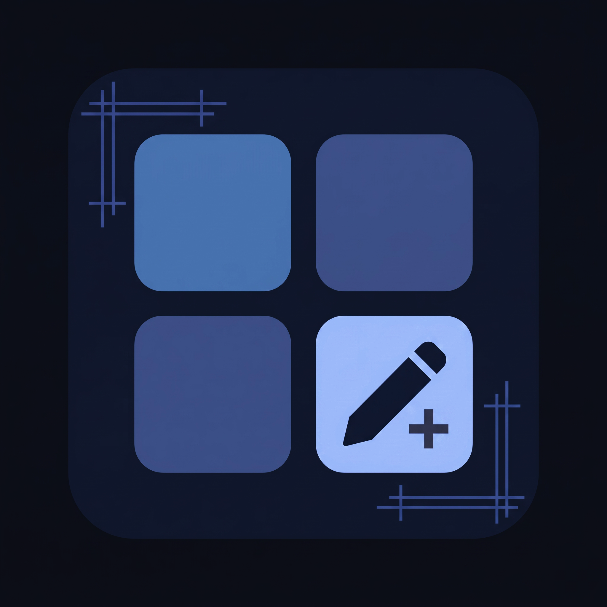

<div align="center">

<p align="center">
  
</p>

# QuickSetTiles

<p align="center">
  <b>A powerful, modern Android Quick Settings tile creator and manager built with Jetpack Compose & Material 3.</b>
</p>

<p align="center">
  
  
  
  
  
</p>

</div>

## ✨ Features

- **Intuitive Bottom Navigation**:
  - **Active Tiles Tab** (Left): Displays currently active quick settings tiles.
    - *Tap*: Inactivates the tile and moves it to the Inactive tab.
    - *Long press*: Opens the tile editor.
  - **Floating Plus (+) Button** (Center): Elevated Material 3 FAB to create new quick setting tiles.
  - **Inactive Tiles Tab** (Right): Displays inactive tiles.
    - *Tap*: Activates the tile and assigns it to an active quick settings slot.
    - *Long press*: Opens the tile editor or delete options.

- **8 Versatile Tile Types**:
  1. 📱 **Apps**: Floating menu with real-time search across all apps (including system apps).
  2. 🌐 **Website**: Add a custom label and URL to launch directly in your default browser.
  3. ⚡ **Shortcut**: Select from inbuilt application shortcuts.
  4. 🧩 **Activity**: Full-page explorer of installed apps with accordion drop-downs of all activities.
     - *Tap*: Selects the activity for your tile.
     - *Long press*: Live test launch to verify execution before saving!
  5. 📨 **Intent**: Custom broadcast or activity intents with package name, action, and URI.
  6. 🐚 **Shell**: Execute shell commands or scripts using **Shizuku API** or Superuser root (`su`) with live output feedback.
  7. 📄 **Files**: Select any file to open instantly from your Quick Settings panel.
  8. 📁 **Folders**: Select any directory to open in the system file manager.

- **🔒 Inbuilt Private Activities & Shizuku Plugin**:
  - Launch unexported/private activities that are normally blocked by Android's permissions using Shizuku (UID 2000) or Superuser root (`su`).
  - Activities explorer clearly marks "Private (Shizuku)" vs "Exported" activities.
  - Built-in handler for `activitylauncher.intent.action.LAUNCH_ACTIVITY` — QuickSetTiles acts as a drop-in internal Shizuku plugin for Activity Launcher and external tools without needing extra plugin APKs.

- **🎨 Advanced Icon Customization**:
  - Live icon preview reflecting all adjustments in real time.
  - Choose custom images from device storage via file picker.
  - Choose from built-in preset vector icons (Web, Terminal, Folder, File, Settings, Star, Flashlight, etc.).
  - Default App Icon automatically applied when picking an App or Activity.
  - Sliders for **Outline Thickness** (0 dp to 10 dp), **Outline Threshold** (0% to 100%), and **Icon Size** (16 dp to 64 dp).

- **⚡ Quick Settings Tile Integration**:
  - 15 pre-configured `TileService` slots dynamically mapped to your active tiles.
  - Direct prompt to add tiles to the status bar on modern Android devices.

- **🔑 Uniform & Consistent APK Signing Across All Releases**:
  - Every release APK and debug APK is signed using the **exact same permanent release keystore** (`keystore/release.jks`).
  - Seamless in-place updates: users will never encounter `INSTALL_FAILED_UPDATE_INCOMPATIBLE` when updating from one build or release to another.
  - Automatic GitHub Releases triggered on version tags (`v*`) or manual workflow dispatch.

- **🌙 Material 3 Design**:
  - Dynamic Color theming.
  - Full Dark Mode and Light Mode support.

---

## 🚀 Building & Releases

Automated builds and releases are powered by **GitHub Actions**:

1. **Workflow Artifacts**:
   - Navigate to the **Actions** tab on GitHub: [QuickSetTiles Actions](https://github.com/wizzwuz/QuickSetTiles/actions).
   - Click on the latest workflow run.
   - Download `QuickSetTiles-release-apk` or `QuickSetTiles-debug-apk`. Both are signed with the permanent release keystore.
2. **GitHub Releases**:
   - Pushing any tag (e.g. `v1.0.0`) automatically publishes a GitHub Release with the signed APK attached.
   - Can also be dispatched manually via the Actions UI (`create_release: true`).

To build locally:
```bash
./gradlew assembleRelease assembleDebug
```

---

## 💖 Credits & Open Source Acknowledgements

QuickSetTiles is built on top of and made possible by these incredible open-source projects, libraries, and design systems:

| Project / Library | Maintainer / Author | License | Description & Purpose |
| :--- | :--- | :--- | :--- |
| **[Shizuku](https://github.com/RikkaApps/Shizuku)** | [RikkaApps](https://github.com/RikkaApps) | [Apache 2.0](https://www.apache.org/licenses/LICENSE-2.0) | Provides the elevated permissions interface (UID 2000 shell / ADB / Root) enabling rootless shell execution and launching unexported activities. |
| **[AndroidSVG](https://github.com/BigBadaboom/androidsvg)** | [Paul LeBeau (caverock)](https://github.com/BigBadaboom) | [Apache 2.0](https://www.apache.org/licenses/LICENSE-2.0) | High-performance SVG parsing and rendering engine used to rasterize all 57,000+ Material preset vector icons onto Android Canvases and Bitmaps. |
| **[Coil](https://github.com/coil-kt/coil)** | [Coil Contributors](https://github.com/coil-kt) | [Apache 2.0](https://www.apache.org/licenses/LICENSE-2.0) | Fast, lightweight, Kotlin coroutine-first image loading library. |
| **[ProGuard](https://github.com/Guardsquare/proguard)** | [Guardsquare](https://github.com/Guardsquare) | [GPL 2.0](https://www.gnu.org/licenses/old-licenses/gpl-2.0.html) | Industry-standard optimizer, shrinker, and obfuscator used via `proguard-rules.pro` to minify release APK builds and strip unused bytecode. |
| **[Material Symbols](https://icon-sets.iconify.design/material-symbols/)** | [Iconify](https://github.com/iconify) & [Google](https://github.com/google) | [Apache 2.0](https://www.apache.org/licenses/LICENSE-2.0) | Extensive dataset of 57,000+ vector glyphs spanning Outlined, Rounded, and Sharp variants powering the preset icon catalog. |
| **[Google Material Design Icons](https://github.com/google/material-design-icons)** | [Google LLC](https://github.com/google) | [Apache 2.0](https://www.apache.org/licenses/LICENSE-2.0) | Official baseline Material Design vector icon specification and asset catalog. |
| **[Kotlin & Coroutines](https://github.com/JetBrains/kotlin)** | [JetBrains](https://github.com/JetBrains) | [Apache 2.0](https://www.apache.org/licenses/LICENSE-2.0) | Modern programming language, Compose compiler plugin, and `kotlinx.coroutines` powering asynchronous background loading and I/O tasks. |
| **[Gradle](https://github.com/gradle/gradle)** | [Gradle Inc.](https://github.com/gradle) | [Apache 2.0](https://www.apache.org/licenses/LICENSE-2.0) | Build automation system and wrapper powering the continuous integration, dependency management, and APK assembly. |
| **[Pillow (PIL)](https://github.com/python-pillow/Pillow)** | [Alex Clark and Contributors](https://github.com/python-pillow) | [HPND](https://github.com/python-pillow/Pillow/blob/main/LICENSE) | Python imaging library used in automated CI/CD workflows for adaptive foreground and mipmap launcher icon synthesis. |

---

## 📄 License

This project is licensed under the **GNU General Public License v3.0** (GPLv3) - see the [LICENSE](LICENSE) file for details.
